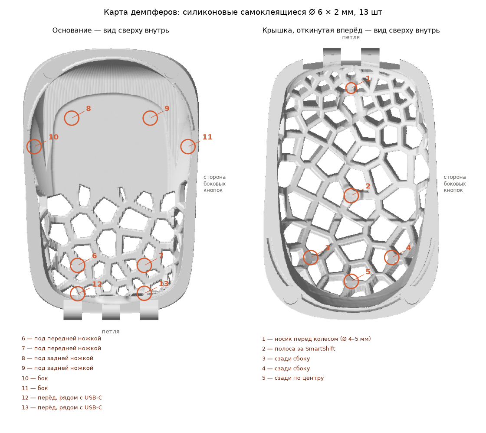

# MX Anywhere 3 case — printing and assembly

**English** · [Русский](PRINTING.ru.md)

## Print files

Ready-made files are attached to [the latest release](https://github.com/Yarad/mx-anywhere-3-case/releases/latest). To build them yourself, `.venv/bin/python -m case mx-anywhere-3 build print` writes them to `build/mx-anywhere-3/print/` (for another mouse, its folder name in `mice/`):

| File | What it is |
| --- | --- |
| `mx_case_plate.3mf` | both parts on one plate, already in print orientation |
| `mx_case_base.stl` | the base, in print orientation |
| `mx_case_lid.stl` | the lid, in print orientation |

The bumper map comes from `.venv/bin/python -m case mx-anywhere-3 bumper_map`: `build/mx-anywhere-3/print/bumper_map.png` (Russian version: `bumper_map.ru.png`).

## Ordering a print

The order zip from the release (or `.venv/bin/python -m case mx-anywhere-3 order`, which builds `build/mx-anywhere-3/mx-anywhere-3_case_order.zip`) is ready to send to a print shop:

| In the zip | What it is |
| --- | --- |
| `case_base_PETG_gray.stl` | the base — **grey PETG** |
| `case_lid_PETG_white-transparent.stl` | the lid — **translucent white PETG** |
| `zakaz.txt` | the order text: colours, orientation on the bed, supports, settings (in Russian) |
| `na_stole.png`, `cveta.png` | the parts as they lie on the bed, and the finished case |

The colours are `[design] colors` in the mouse's `case.toml` (names from `case/colors.py`), and the order's language is `[print] order_language` (`ru` or `en`; in English the files are `order.txt`, `on_the_bed.png`, `finished_case.png`). An STL has no colour, so it goes into the file name and the order text. Parts in different colours are printed as separate jobs.

## Print settings

- **Material:** PETG.
- **Printer:** anything with a 220 × 220 mm bed or larger; both parts fit on one plate.
- **Nozzle / layer:** 0.4 mm / 0.2 mm.
- **Walls:** 3 perimeters, 100 % infill — the parts are thin, so they are practically solid anyway.
- **Base:** flat bottom on the bed. **No supports.**
- **Lid:** flat rim (the parting plane) on the bed, dome up. **Tree supports from the build plate only** — they grow inside the dome and hold the lattice ribs from below. There must be no supports on the outside of the lid.
- **Hinge holes** have a teardrop top and print without supports.
- Do not change the orientation: the files already have the right one.

## What to buy

| What | How many |
| --- | --- |
| Neodymium disc magnets 6 × 2 mm | 4 |
| Rod or screw Ø 3 mm, 40 mm long (M3 × 40 screw, steel rod or knitting needle) | 1 |
| Self-adhesive silicone bumpers Ø 6 × 2 mm | 12 |
| Bumper Ø 4–5 × 2 mm (or a piece of one) for the nose in front of the wheel | 1 |
| Glue: cyanoacrylate (super glue) or epoxy | for the magnets |

## Assembly

1. **Magnets.** There is a Ø 6.2 mm pocket in each back corner of the lid and of the base. Stack all 4 magnets in one column and mark the top face of each. Glue them into the base **marked face out** (towards the parting line) and into the lid **marked face into the pocket** (towards its bottom). Check that the lid pulls shut before the glue sets.
2. **Hinge.** Line up the knuckles of the lid and the base and push the rod through: it is a press fit in the base knuckles (Ø 3.0) and turns freely in the lid knuckles (Ø 3.25). If it is too tight, run a 3.2–3.3 mm drill through the lid holes.
3. **Bumpers** — following the map below: 8 in the base, 5 in the lid. Each one goes on a thickened lattice node or on solid wall, right at its number. The mouse touches the case only through them; everything else is 1.7 mm away from the mouse.

## If something does not fit

Change the mouse's `case.toml` (defaults with comments are in `case/defaults.toml`) and rebuild with one command:

- a different rod — `[parts] rod` (the lid's holes are 0.25 mm wider: `[tech] rod_play`);
- different bumpers — `[parts] bumper` (the gap is the bumper's height − 0.3 mm);
- a lip that is too tight or too loose — `[tech] lip_clear`;
- different magnets — `[parts] magnet`.
