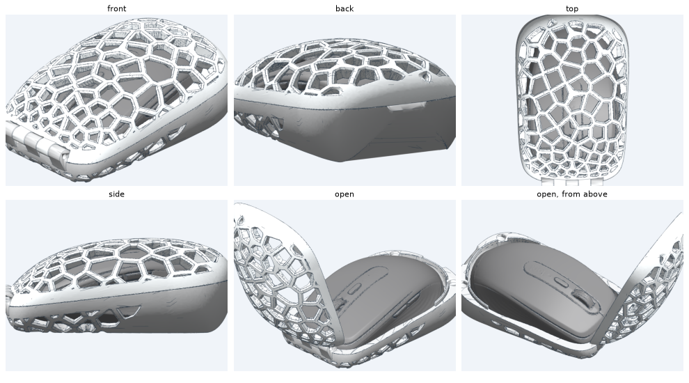
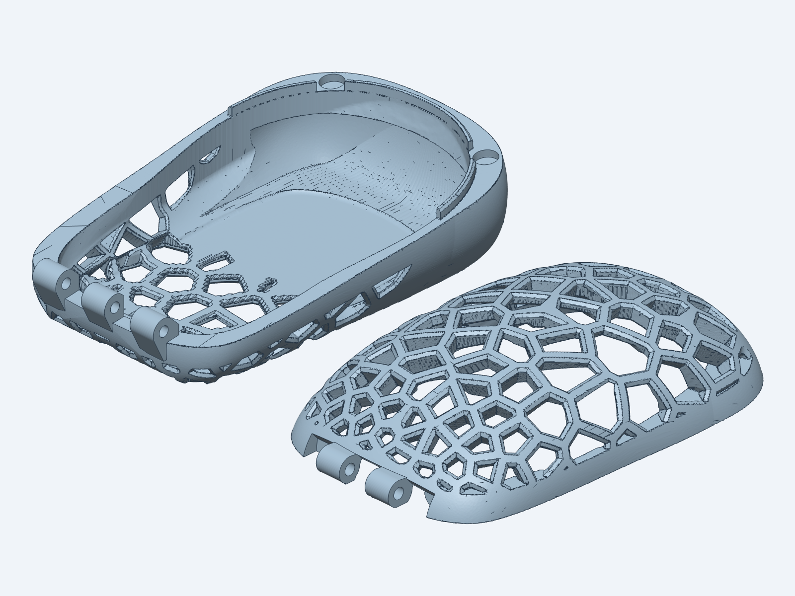
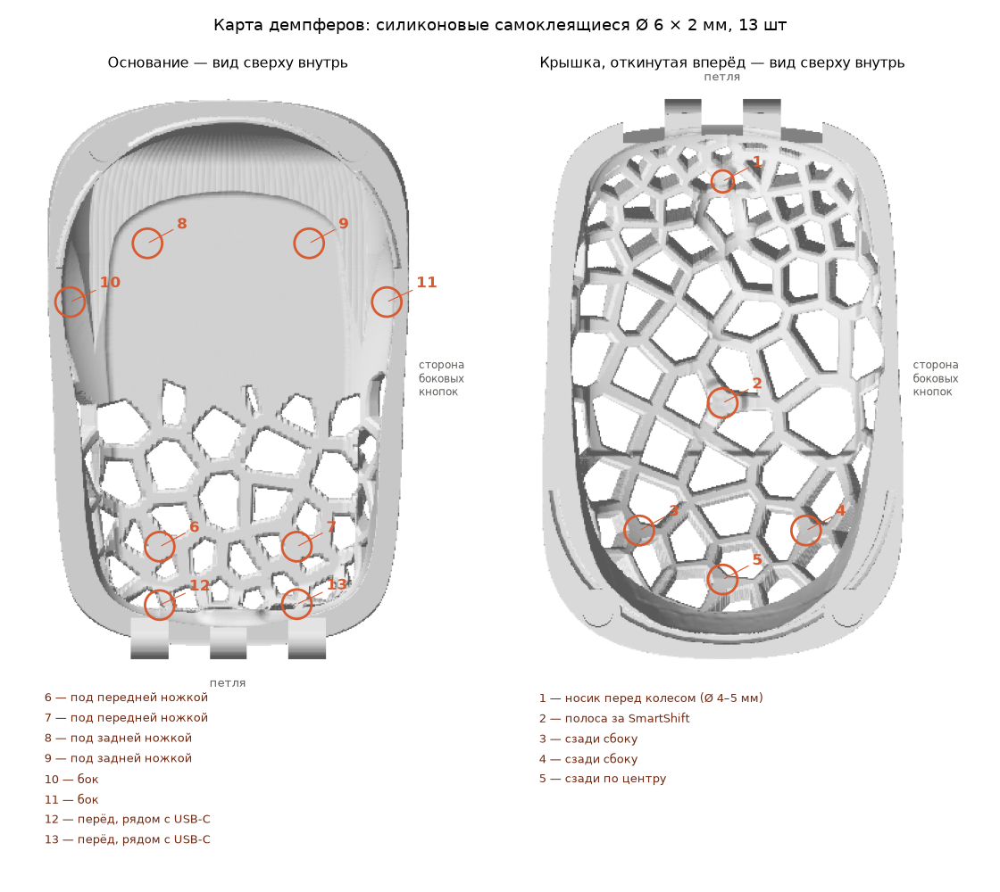

# MX Anywhere 3 case

**English** · [Русский](README.ru.md)

A 3D-printable hard carry case for the Logitech MX Anywhere 3 mouse. Its one job: when the mouse is thrown into a backpack, nothing presses its buttons. The same code makes one for [any other mouse](#a-case-for-your-own-mouse).



Rotate it in 3D right on GitHub: [closed](mice/mx-anywhere-3/3d/case_closed.stl) · [open](mice/mx-anywhere-3/3d/case_open.stl).

- **Lid and base**, printed separately and joined at the front by a printed 5-knuckle hinge on a 3 mm rod; held shut at the back by two pairs of 6 × 2 mm magnets; a lip around the back keeps the halves from sliding. A finger notch at the back, like the one on a MacBook Pro, lets you lift the lid: the base's edge is chamfered at 45° under it for 20 mm.
- **Voronoi lattice** cut through the wall as wedge-shaped ribs (octagonal from the outside, narrowing towards the mouse). A solid "heel" at the back and bottom dissolves into large cells; cells shrink only towards the hinge.
- **The mouse touches the case at 13 points only**, through 2 mm self-adhesive silicone bumpers: on thickened lattice nodes or on solid wall. Everything else stays 1.7 mm away; the wheel, SmartShift and both main buttons get at least 3 mm, the side buttons 2.5 mm.
- **About 72 g of PETG**, 75 × 115 × 44 mm.

**Just want to print it?** Download the ready files from [Releases](https://github.com/Yarad/mx-anywhere-3-case/releases/latest): STLs and a 3MF plate in print orientation, and the order package for a print shop. You need neither Python nor the mouse scan for that.

## How it is built

Everything is code, in `case/`; each mouse's settings are in `mice/<mouse>/`. The organic parts are signed distance fields on a 0.2–0.3 mm grid; the mechanical parts are exact meshes.

1. **Outer form** (`form.py`): three Bézier curves, a top-view outline, a side profile and a normalised cross-section, swept into one smooth body. The MX Anywhere 3's was drawn by hand; for another mouse `fit.py` moves the same few nodes until the form holds the cavity under at least 2 mm of material.
2. **Cavity** (`fields.py`): the mouse scan offset by a gap that depends on the zone (buttons, contacts, everything else), then swept along both ways the case opens: lifting the mouse out of the base, and rotating the lid about the hinge axis. So nothing collides while opening.
3. **Parting plane and lip**: a plane tilted about 6° through the widest points of the mouse's nose and back.
4. **Lattice** (`lattice.py`): Voronoi seeds on the outer surface, with density from the composition (heel, belt along the parting line, hinge, magnets) and three seeds around every contact so a node lands right over it. Each wall voxel is projected onto the outer surface; its distance to the nearest Voronoi edge against the rib's depth profile decides rib or hole.
5. **Meshes** (`build.py`, `hinge.py`, `notch.py`): marching cubes, then [manifold3d](https://github.com/elalish/manifold) booleans for the knuckles, teardrop pin holes, magnet pockets and the finger notch.
6. **Checks**: no overlap with the mouse, no overlap between lid and base, free opening up to 120°, wall thickness, overhangs.

## A case for your own mouse

The same code makes this kind of case for any mouse, from a 3D scan or just its length, width and height. The easiest way is the `mouse-case` skill for [Claude Code](https://claude.com/claude-code) in this repository: clone it, open it in Claude Code and ask for a case for your mouse (or type `/mouse-case`). It takes your mouse in, shows pictures of every design choice — lattice, where it stays solid, cell size, rib, hinge end, colours and more — builds the case and prepares the print files and an order for a print shop. The choices, with the MX Anywhere 3's as defaults, are listed in [the skill's parameter reference](.claude/skills/mouse-case/references/parameters.md).

By hand, without the skill:

```bash
.venv/bin/python -m case my-mouse new --scan my-mouse.stl --side-buttons left   # or --dims 107 59 26.5
.venv/bin/python -m case my-mouse options composition   # pictures of a design choice
.venv/bin/python -m case my-mouse build stage2
```

Each mouse lives in `mice/<mouse>/`: `case.toml` (the mouse's buttons and contacts, the design choices), `derived.toml` (the outer form and the rest fitted to the mouse) and `seeds.npy` (the approved lattice).

## Usage

Only needed to change the design. Python 3.11+ and [uv](https://github.com/astral-sh/uv):

```bash
uv venv .venv
uv pip install --python .venv/bin/python -r requirements.txt
```

The mouse scan is **not included** (see below). Put a watertight STL of the MX Anywhere 3 at `Logitech MX Anywhere 3.stl` in the repository root, in this frame: millimetres, front (USB-C, wheel) towards −Y, side buttons towards +X, feet standing on z = −0.57. The contacts in `mice/mx-anywhere-3/case.toml` are placed for that frame.

```bash
.venv/bin/python -m case mx-anywhere-3 build stage1   # solid shell, no lattice
.venv/bin/python -m case mx-anywhere-3 build stage2   # with the lattice, 0.3 mm grid
.venv/bin/python -m case mx-anywhere-3 build print    # print-ready, 0.2 mm grid, parts in print orientation
.venv/bin/python -m case mx-anywhere-3 checks         # thin walls and overhangs of the print files
.venv/bin/python -m case mx-anywhere-3 bumper_map     # where the bumpers go
.venv/bin/python -m case mx-anywhere-3 order          # zip for the print shop, with the chosen colours
.venv/bin/python -m case mx-anywhere-3 preview github # light STLs in mice/mx-anywhere-3/3d for GitHub's 3D viewer
```

Results go to `build/<mouse>/`. The first run takes a few minutes (distance fields are cached in `build/cache`); later runs take about a minute. The colour sheet and the bed picture of the order use the `cadgen` CLI from [text-to-cad](https://github.com/earthtojake/text-to-cad); the build itself does not need it.

All dimensions (gaps, hinge, magnets, lip, rib profile, cell sizes) have defaults with comments in `case/defaults.toml`; a mouse's `case.toml` overrides them. The approved lattice layout is pinned in `mice/mx-anywhere-3/seeds.npy`; delete it to roll a new one.

## Printing



- **Base**: flat bottom on the bed, no supports.
- **Lid**: rim on the bed, dome up; tree supports from the build plate only (they grow inside the dome).
- PETG, 0.4 mm nozzle, 0.2 mm layers, 3 walls, 100 % infill.

The print files are in [the latest release](https://github.com/Yarad/mx-anywhere-3-case/releases/latest). Parts you need: 4 magnets 6 × 2 mm, a 3 mm rod 40 mm long (an M3 × 40 screw works), 13 silicone bumpers 6 × 2 mm. Print settings, assembly and the order package for a print shop are in [PRINTING.md](PRINTING.md).



## The mouse scan

The case is fitted to a 3D scan of the mouse that was found in a public repository. Its licence is unclear, so it is not redistributed here. Any accurate scan of the MX Anywhere 3 in the frame above will do.

## Licence

[CC BY-NC 4.0](LICENSE): print it, use it, share it and remix it for personal, non-commercial purposes, with credit. Selling the case, the files or prints of them needs permission.
