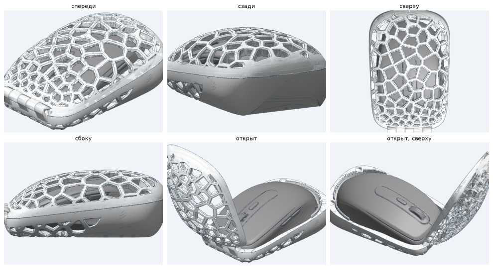
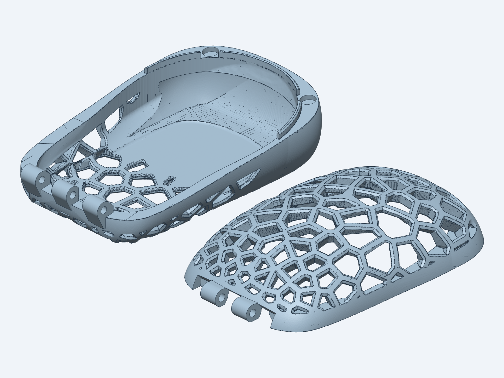
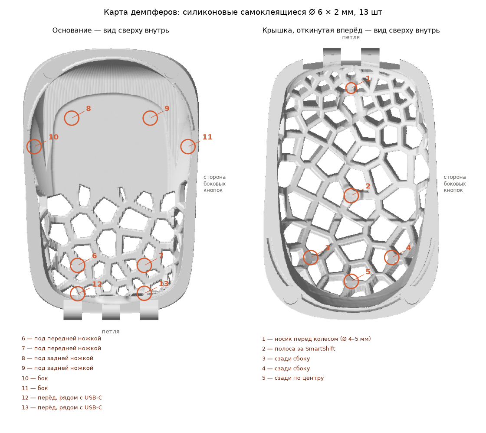

# Чехол MX Anywhere 3

[English](README.md) · **Русский**

Жёсткий чехол для мыши Logitech MX Anywhere 3, напечатанный на 3D-принтере. Его единственная задача: когда мышь брошена в рюкзак, ничто не нажимает её кнопки. Тот же код делает такой чехол и для [любой другой мыши](#чехол-для-своей-мыши).



Покрутить в 3D прямо на GitHub: [закрытый](mice/mx-anywhere-3/3d/case_closed.stl) · [открытый](mice/mx-anywhere-3/3d/case_open.stl).

- **Крышка и основание** печатаются отдельно. Спереди их соединяет печатная петля из 5 проушин на прутке 3 мм, сзади держат две пары магнитов 6 × 2 мм, а бортик вокруг задника не даёт половинкам сдвигаться.
- **Сетка Вороного** прорезана сквозь стенку рёбрами-клиньями: снаружи ребро восьмигранное, к мыши сужается. Сплошная «пятка» сзади и снизу переходит в крупные ячейки, мелкими ячейки становятся только у петли.
- **Мышь касается чехла всего в 13 точках** — через самоклеящиеся силиконовые демпферы высотой 2 мм, на утолщённых узлах сетки или на сплошной стенке. Всё остальное в 1.7 мм от мыши, над колесом, SmartShift и обеими основными клавишами — не меньше 3 мм, над боковыми кнопками — 2.5 мм.
- **Около 72 г PETG**, габарит 75 × 115 × 44 мм.

**Нужно просто напечатать?** Готовые файлы — в [релизах](https://github.com/Yarad/mx-anywhere-3-case/releases/latest): STL и стол 3MF в положении для печати и архив заказа для салона печати. Ни Python, ни скан мыши для этого не нужны.

## Как это устроено

Всё описано кодом в папке `case/`, настройки каждой мыши — в `mice/<мышь>/`. Органичные части — поля расстояний (SDF) на сетке 0.2–0.3 мм, механические — точные сетки.

1. **Внешняя форма** (`form.py`): три кривые Безье — контур сверху, профиль сбоку и нормированное сечение — сведены в одно гладкое тело. Для MX Anywhere 3 она нарисована вручную; для другой мыши `fit.py` двигает те же несколько узлов, пока форма не накроет полость слоем материала не тоньше 2 мм.
2. **Полость** (`fields.py`): скан мыши, раздутый на зазор, который зависит от зоны (кнопки, точки контакта, всё остальное), и протянутый по обоим движениям при открывании: подъём мыши из основания и поворот крышки вокруг оси петли. Поэтому при открывании ничего не цепляется.
3. **Плоскость разъёма и бортик**: плоскость с наклоном около 6° через самые широкие места носа и задника мыши.
4. **Сетка** (`lattice.py`): точки Вороного на внешней поверхности. Их плотность задаёт композиция (пятка, пояс вдоль линии разъёма, петля, магниты), а вокруг каждой точки контакта ставятся три точки, чтобы узел сетки пришёлся ровно над ней. Каждый воксель стенки проецируется на внешнюю поверхность; расстояние до ближайшего ребра Вороного в сравнении с профилем ребра по глубине решает, ребро здесь или отверстие.
5. **Сетки** (`build.py`, `hinge.py`): marching cubes, затем булевы операции [manifold3d](https://github.com/elalish/manifold) для проушин, каплевидных отверстий под ось и гнёзд магнитов.
6. **Проверки**: нет пересечений с мышью и между крышкой и основанием, крышка свободно открывается до 120°, толщина стенок, нависания.

## Чехол для своей мыши

Тот же код делает такой чехол для любой мыши — по 3D-скану или просто по длине, ширине и высоте. Проще всего через скил `mouse-case` для [Claude Code](https://claude.com/claude-code), он лежит в этом репозитории: склонируйте его, откройте в Claude Code и попросите чехол для своей мыши (или наберите `/mouse-case`). Скил примет мышь, покажет картинки каждого варианта дизайна — сетка, где сплошной материал, размер ячеек, сечение ребра, где петля, цвета и другое — соберёт чехол и подготовит файлы для печати и заказ для салона. Все параметры, со значениями MX Anywhere 3 по умолчанию, — в [справочнике скила](.claude/skills/mouse-case/references/parameters.md).

Вручную, без скила:

```bash
.venv/bin/python -m case my-mouse new --scan my-mouse.stl --side-buttons left   # или --dims 107 59 26.5
.venv/bin/python -m case my-mouse options composition   # картинки одного варианта дизайна
.venv/bin/python -m case my-mouse build stage2
```

У каждой мыши своя папка `mice/<мышь>/`: `case.toml` (кнопки и точки опоры мыши, выбор дизайна), `derived.toml` (внешняя форма и остальное, подогнанное под мышь) и `seeds.npy` (утверждённый рисунок сетки).

## Использование

Это нужно, только чтобы менять конструкцию. Нужны Python 3.11+ и [uv](https://github.com/astral-sh/uv):

```bash
uv venv .venv
uv pip install --python .venv/bin/python -r requirements.txt
```

Скан мыши в репозиторий **не входит** (см. ниже). Положите герметичный STL MX Anywhere 3 в корень репозитория под именем `Logitech MX Anywhere 3.stl`, в такой системе координат: миллиметры, перёд (USB-C, колесо) — в сторону −Y, боковые кнопки — в сторону +X, ножки стоят на z = −0.57. Точки контакта в `mice/mx-anywhere-3/case.toml` расставлены именно для неё.

```bash
.venv/bin/python -m case mx-anywhere-3 build stage1   # сплошная оболочка, без сетки
.venv/bin/python -m case mx-anywhere-3 build stage2   # с сеткой, шаг 0.3 мм
.venv/bin/python -m case mx-anywhere-3 build print    # для печати: шаг 0.2 мм, детали в печатном положении
.venv/bin/python -m case mx-anywhere-3 checks         # тонкие стенки и нависания в файлах для печати
.venv/bin/python -m case mx-anywhere-3 bumper_map     # куда клеить демпферы
.venv/bin/python -m case mx-anywhere-3 order          # архив для салона печати с выбранными цветами
.venv/bin/python -m case mx-anywhere-3 preview github # облегчённые STL в mice/mx-anywhere-3/3d для 3D-просмотра на GitHub
```

Результаты складываются в `build/<мышь>/`. Первый запуск занимает несколько минут (поля расстояний кешируются в `build/cache`), следующие — около минуты. Для листа цветов и картинки стола в заказе нужна утилита `cadgen` из [text-to-cad](https://github.com/earthtojake/text-to-cad); сама сборка без неё обходится.

Все размеры (зазоры, петля, магниты, бортик, профиль ребра, размер ячеек) со значениями по умолчанию и пояснениями — в `case/defaults.toml`; `case.toml` мыши их переопределяет. Утверждённый рисунок сетки зафиксирован в `mice/mx-anywhere-3/seeds.npy`; удалите файл, чтобы получить новый.

## Печать



- **Основание**: дном на столе, без поддержек.
- **Крышка**: краем на столе, куполом вверх; древовидные поддержки только от стола (растут внутри купола).
- PETG, сопло 0.4 мм, слой 0.2 мм, 3 периметра, заполнение 100 %.

Файлы для печати — в [последнем релизе](https://github.com/Yarad/mx-anywhere-3-case/releases/latest). Понадобятся: 4 магнита 6 × 2 мм, пруток 3 мм длиной 40 мм (подойдёт винт M3 × 40), 13 силиконовых демпферов 6 × 2 мм. Настройки печати, сборка и архив заказа для салона — в [PRINTING.ru.md](PRINTING.ru.md).



## Скан мыши

Чехол подогнан под 3D-скан мыши, найденный в публичном репозитории. Его лицензия неясна, поэтому здесь он не распространяется. Подойдёт любой точный скан MX Anywhere 3 в описанной выше системе координат.

## Лицензия

[CC BY-NC 4.0](LICENSE): печатать, пользоваться, делиться и переделывать можно для личных некоммерческих целей с указанием автора. Продавать чехол, файлы или отпечатки без разрешения нельзя.
